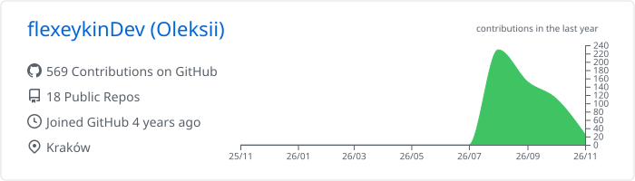
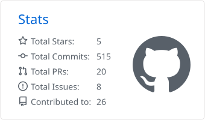
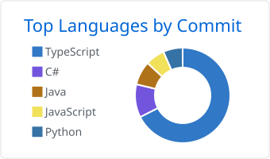

I studied cybersecurity and now I mostly work on detection: writing Sigma rules for Windows and checking them against real attack logs to see what they actually catch and what they miss.

Looking for my first job in a SOC or IT support team, in Kraków or remote. I have the right to work in Poland.

---

### soc-detection-lab

[github.com/flexeykinDev/soc-detection-lab](https://github.com/flexeykinDev/soc-detection-lab)

Three Sigma rules tested on 278 real EVTX attack captures from a public dataset. They fired 17 times across 15 captures, including mimikatz, Meterpreter and MalSeclogon.

A few things I learned along the way:

- The LSASS rule looks at process access masks instead of file names, so it still works when a tool is renamed.
- I converted the rules to Splunk SPL and to KQL for Defender XDR. One of them didn't convert to KQL, and the README explains why.
- My first PowerShell rule had false positives on the remoting host. I narrowed it down and kept the real attacks.

     

---

### What I work with

**Security and IT**

   

**Used in my projects**

---

### Projects

Side projects I built with AI help. I made the decisions, tested and fixed them, and got them working.

<table>
<tr>
<td width="50%" valign="top">
<a href="https://github.com/flexeykinDev/lumen"><b>lumen</b></a> 
Now-playing capsule for the Windows 11 taskbar. Works with any player, per-app volume, synced lyrics and Discord status. One portable exe.  

</td>
<td width="50%" valign="top">
<a href="https://github.com/flexeykinDev/ShadowPlay_Patcher"><b>ShadowPlay_Patcher</b></a> 
Tray app that stops NVIDIA Instant Replay from turning itself off on protected content. Win32 API hooking in C++.  

</td>
</tr>
<tr>
<td width="50%" valign="top">
<a href="https://github.com/flexeykinDev/dbd-perk-randomizer"><b>dbd-perk-randomizer</b></a> · <a href="https://flexeykindev.github.io/dbd-perk-randomizer/">live</a> 
Perk randomizer and OBS overlay for Dead by Daylight streams. Perk data is scraped from the wiki and updated by GitHub Actions.  

</td>
<td width="50%" valign="top">
<a href="https://github.com/flexeykinDev/dota-counter-web"><b>dota-counter-web</b></a> · <a href="https://flexeykindev.github.io/dota-counter-web/">live</a> 
Interactive map of Dota 2 counter-picks: who beats who, why, and which item shuts them down. Built from 2M+ high-rank games.  

</td>
</tr>
<tr>
<td width="50%" valign="top">
<a href="https://github.com/flexeykinDev/steam-autolike"><b>steam-autolike</b></a> 
Firefox extension that likes friends' posts in the Steam feed and leaves one emoticon comment. It stops by itself when Steam's anti-spam limit kicks in.  

</td>
<td width="50%" valign="top">
<a href="https://github.com/flexeykinDev/thaumcraft4-1.20"><b>thaumcraft4-1.20</b></a> 
Unofficial fan port of the Thaumcraft 4 mod to Minecraft 1.20.1, for Forge and NeoForge.  

</td>
</tr>
</table>

---

### Open source

Merged pull requests to other people's projects.

<table>
<tr>
<td width="50%" valign="top">
<a href="https://github.com/KnifeLemon/Filee"><b>Filee</b></a> · <a href="https://github.com/KnifeLemon/Filee/pulls?q=is%3Apr+is%3Amerged+author%3AflexeykinDev">my PRs</a> 
Offline file converter. I added quick clip trimming and window zoom, and fixed leftover temp folders and half-written files after a failed conversion.  

</td>
<td width="50%" valign="top">
<a href="https://github.com/Cranch-fur/Cursed-Market"><b>Cursed-Market</b></a> · <a href="https://github.com/Cranch-fur/Cursed-Market/pulls?q=is%3Apr+is%3Amerged+author%3AflexeykinDev">my PRs</a> 
Windows proxy tool. I made it stop wiping the user's proxy settings on exit, accept only http(s) links from update responses, and warn when traffic isn't going through the proxy.  

</td>
</tr>
</table>

---

### GitHub activity

<picture>
  <source media="(prefers-color-scheme: dark)" srcset="./profile-summary-card-output/github_dark/0-profile-details.svg">
  
</picture>

<picture>
  <source media="(prefers-color-scheme: dark)" srcset="./profile-summary-card-output/github_dark/3-stats.svg">
  
</picture>
<picture>
  <source media="(prefers-color-scheme: dark)" srcset="./profile-summary-card-output/github_dark/2-most-commit-language.svg">
  
</picture>

---

### Languages

<picture>
  <source media="(prefers-color-scheme: dark)" srcset="https://raw.githubusercontent.com/flexeykinDev/flexeykinDev/output/github-snake-dark.svg">
  
</picture>

